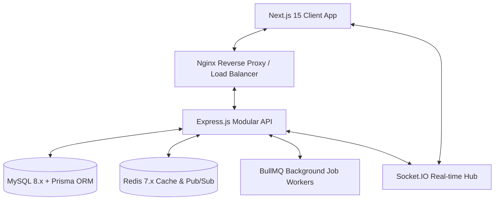

# 🏥 CareConnect — Healthcare SaaS & Doctor-on-Demand Platform

> **Comprehensive Enterprise Healthcare Solution:** Doctor-on-Demand Marketplace + Emergency Doctor Dispatch Platform + EHR Healthcare Management + Payment & Settlement Platform + Multi-Tenant SaaS Platform.

---

## 📌 Table of Contents
- [Architecture Overview](#-architecture-overview)
- [Technology Stack](#-technology-stack)
- [Core Functional Modules](#-core-functional-modules)
- [Project Structure](#-project-structure)
- [Getting Started](#-getting-started)
- [Automated Testing](#-automated-testing)
- [Docker & Production Deployment](#-docker--production-deployment)
- [API Documentation & Swagger](#-api-documentation--swagger)
- [Security & RBAC Roles](#-security--rbac-roles)

---

## 🏛 Architecture Overview

CareConnect follows a **Modular Monolith Architecture** with real-time bidirectional communication and decoupled multi-tenant capabilities:



---

## 🛠 Technology Stack

| Layer | Technologies |
|---|---|
| **Frontend** | Next.js 15 (App Router), React 19, Tailwind CSS, Shadcn/UI, Framer Motion |
| **State Management** | Redux Toolkit & RTK Query |
| **Backend** | Node.js, Express.js (Modular Controllers & Routes) |
| **ORM & Database** | Prisma ORM, MySQL 8.x (Comprehensive Relational Schema) |
| **Real-time Hub** | Socket.IO (Emergency dispatch broadcast, Live chat, Arrival tracking) |
| **Cache & Queues** | Redis, BullMQ (Async notification and auto-settlement workers) |
| **Payments & Invoicing** | Razorpay Gateway, PDFKit (Automated GST invoice generation) |
| **Testing** | Jest, Supertest, Zod schema validation |
| **DevOps & Deploy** | Docker, Docker Compose, Nginx, GitHub Actions CI/CD |

---

## 🌟 Core Functional Modules

### 1. 🧑‍⚕️ Patient Module
- **Doctor Discovery & Filters:** Filter by specialty, consultation fees, distance radius, and live availability.
- **Consultation Booking:** Schedule In-Clinic OPD, Home Visit, or Teleconsultation visits.
- **Emergency Doctor SOS:** 5 km radius emergency dispatch broadcasting to attending doctors via Socket.IO.
- **EHR & Medical Vault (`/patient/records`):** Access digitally signed doctor prescriptions, download PDF reports, and upload diagnostic tests.
- **Wallet & History:** View transaction history, Razorpay receipts, and booking summaries.
- **AI Symptom Checker:** Interactive triage chatbot assisting patients before consultation.

### 2. 🩺 Doctor Module
- **Schedule & Consultations (`/doctor/appointments`):** Daily roster, active consults, and call-in controls.
- **EHR Prescription Builder (`/doctor/prescription/[id]`):** Structured prescription builder with medication dosages, durations, advice, and digital signature.
- **Handover Management (`/doctor/handovers`):** Peer-to-peer transfer of appointments with complete audit trail.
- **Practice Settings (`/doctor/settings`):** Configure OPD, Home Visit, and Emergency fees, service radius (2–30 km), and payout bank details.
- **Doctor Wallet & Settlements:** Tracks gross earnings, platform commission (20%), available balance, and automated 24-hour settlement holds.
- **KYC Credentials (`/doctor/kyc`):** Upload medical council registration, identity documents, and qualification degrees.

### 3. 🏢 Clinic Multi-Tenant SaaS
- **Clinic Dashboard (`/clinic`):** Live doctor roster quotas, patient throughput, and SaaS tier status.
- **SaaS Subscription Upgrade Modal:** Upgrade between Starter (3 doctors), Professional (15 doctors), and Enterprise (unlimited doctors).
- **Staff & Doctor Roster (`/clinic/doctors`):** Manage attending physicians, OPD consultation fees, and active availability.
- **Appointments & Token Queue (`/clinic/appointments`):** Real-time OPD token stream with check-in and room assignments.
- **Patient Registry (`/clinic/patients`):** Master patient index, medical encounter summaries, and walk-in patient registration.
- **Billing & GST Ledgers (`/clinic/billing`):** Track collections, 18% GST breakdown (9% CGST + 9% SGST), and printable ledgers.
- **Clinic Branding & Protocols (`/clinic/settings`):** Subdomain routing (`*.careconnect.in`), facility hours, and SOS node participation.

### 4. 🛡️ Super Admin Panel
- **Operations Overview (`/admin`):** System-wide KPIs, active visits, gross volume, and revenue analytics.
- **Doctor Verification (`/admin/kyc`):** Review and verify submitted medical licenses and certificates.
- **Financial Settlements & Payouts:** Process doctor withdrawal requests with UTR confirmation numbers.
- **Emergency Dispatch Monitoring:** Real-time visibility into active SOS alerts and dispatched doctors.
- **Complaints & Grievances:** Resolve patient-doctor disputes with audit trail logging.

---

## 📁 Project Structure

```
DOC/
├── .github/
│   └── workflows/
│       └── ci.yml               # GitHub Actions Automated CI/CD
├── client/                      # Next.js Frontend Application
│   ├── src/
│   │   ├── app/                 # Next.js App Router (Patient, Doctor, Clinic, Admin)
│   │   ├── components/          # Reusable UI & Business components
│   │   └── store/               # Redux Toolkit & RTK Query APIs
│   └── Dockerfile               # Client production container
├── server/                      # Express.js Backend API
│   ├── prisma/                  # Schema, migrations, and seeds
│   ├── src/
│   │   ├── controllers/         # Business logic handlers
│   │   ├── middlewares/         # Auth, validation, upload middlewares
│   │   ├── routes/              # Express versioned routes (/api/v1)
│   │   ├── services/            # Database and external service integrations
│   │   └── utils/               # Distance, JWT, Hash, OTP utilities
│   ├── tests/                   # Jest Automated Unit & Integration Tests
│   └── Dockerfile               # Backend production container
├── nginx/
│   └── nginx.conf               # Production Nginx reverse proxy configuration
├── docker-compose.yml           # Full-stack container orchestration
└── README.md
```

---

## 🚀 Getting Started

### Prerequisites
- **Node.js:** v18.x or v20.x
- **MySQL:** 8.x
- **Redis:** 6.x or 7.x

### 1. Backend Setup
```bash
cd server
npm install

# Copy and configure environment variables
cp .env.example .env

# Run database migrations and generate Prisma client
npx prisma migrate dev --name init
npx prisma generate

# (Optional) Seed verified doctors
node prisma/seed-doctors.js

# Start backend dev server (Port 5000)
npm run dev
```

### 2. Frontend Setup
```bash
cd ../client
npm install

# Start Next.js dev server (Port 3000)
npm run dev
```

---

## 🧪 Automated Testing

CareConnect includes an automated Jest test suite covering core utilities, Zod validators, financial ledger calculations, and SaaS multi-tenant quota checks.

```bash
cd server
npm test
```

**Test Coverage Summary:**
- ✅ **Haversine Distance Calculator:** Precise distance computation and 5km radius emergency doctor filtering.
- ✅ **Bcrypt Hashing:** Cryptographic password hashing and verification.
- ✅ **JWT Authentication:** Access and refresh token generation, verification, and role payload decoding.
- ✅ **Zod Input Validators:** Appointment lifecycle validation and registration schema safety.
- ✅ **Financial Ledger & SaaS Quotas:** 20% platform commission, 18% GST calculation, tier quota enforcement, and 24-hour settlement hold periods.

---

## 🐳 Docker & Production Deployment

To run the entire platform with MySQL, Redis, Backend, Frontend, and Nginx in a containerized environment:

```bash
docker compose up --build -d
```

- **Web Application:** `http://localhost`
- **Backend API:** `http://localhost/api/v1`
- **Swagger Documentation:** `http://localhost/api/docs`

---

## 📖 API Documentation & Swagger

Interactive Swagger/OpenAPI 3.0 documentation is available when running the backend:
- **URL:** `http://localhost:5000/api/docs`
- **JSON Spec:** `http://localhost:5000/api/docs/swagger.json`

---

## 🔐 Security & RBAC Roles

CareConnect implements strict Role-Based Access Control (RBAC):
- `PATIENT` — Access to patient portal, booking, and EHR vault.
- `DOCTOR` — Access to doctor dashboard, prescription builder, and wallet.
- `CLINIC_ADMIN` — Access to clinic management and SaaS tier quotas.
- `SUPER_ADMIN` — Full platform governance, KYC approvals, and financial payouts.

---

## 📄 License

This project is licensed under the ISC License.
